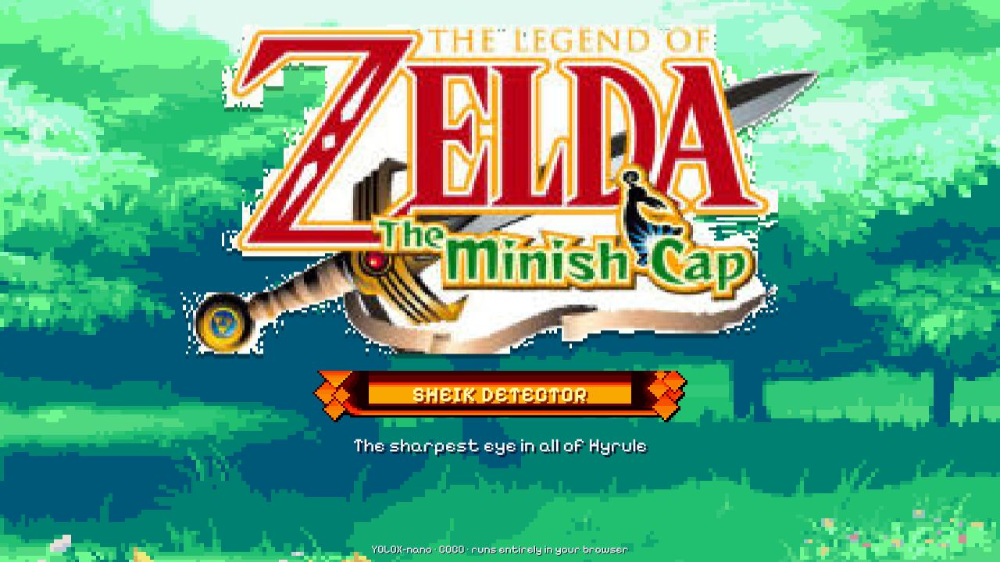
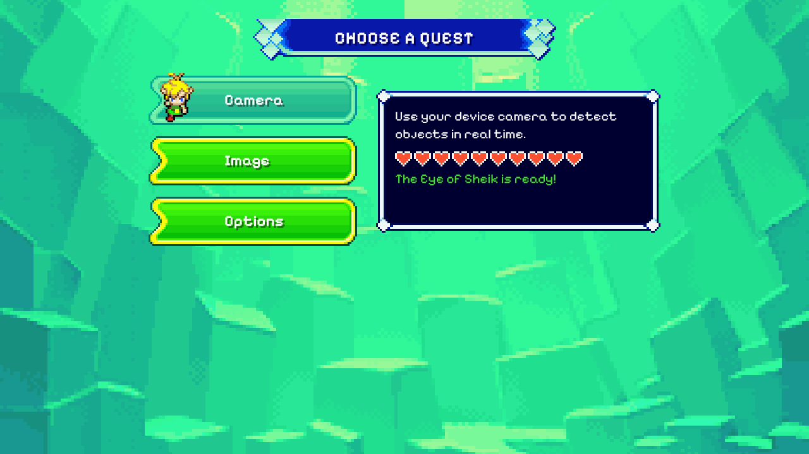
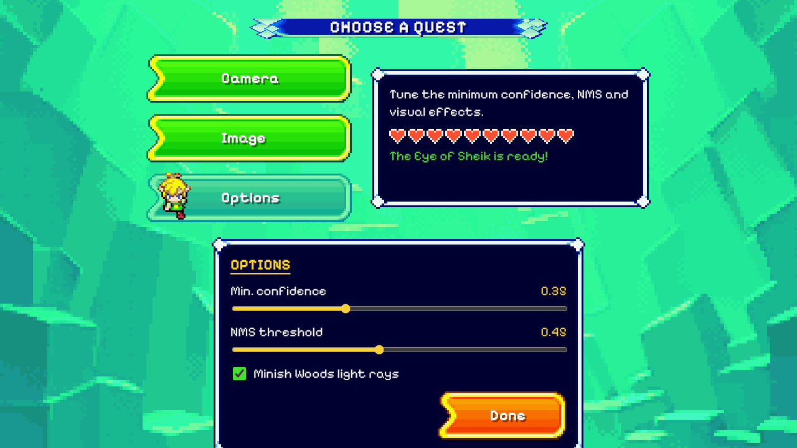
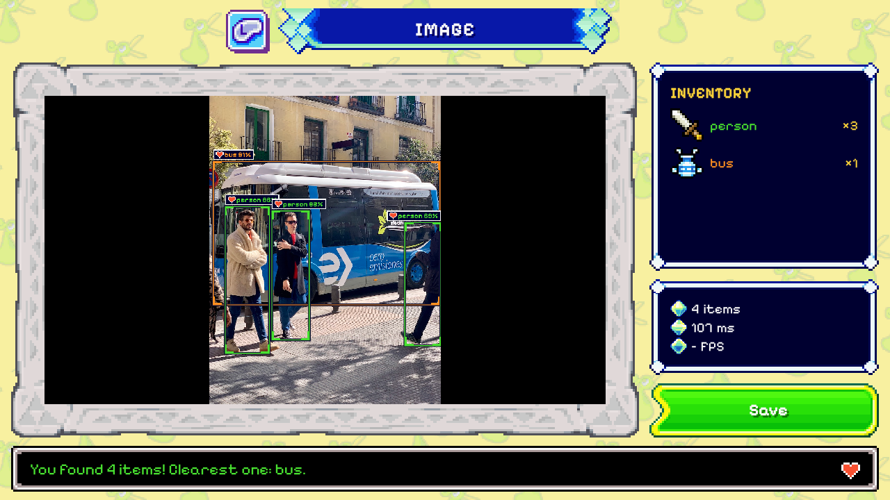
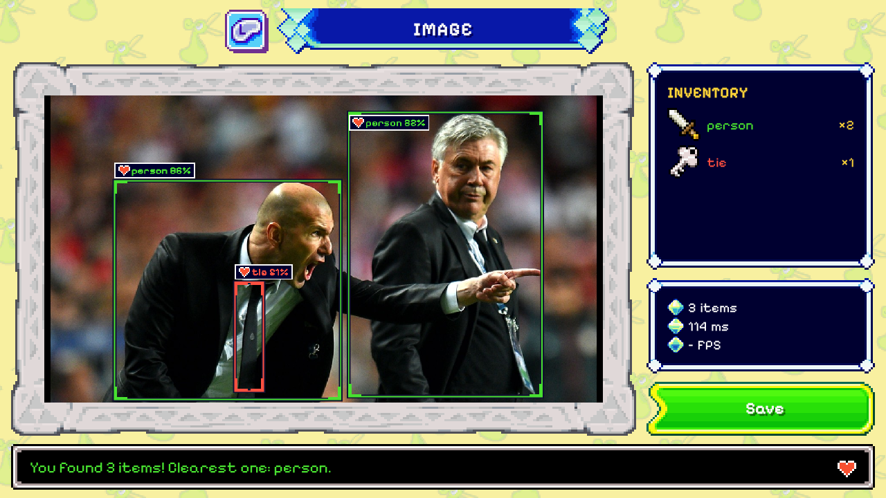
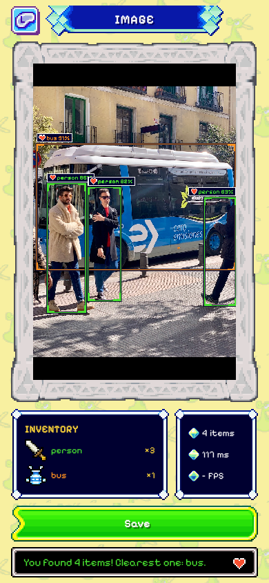
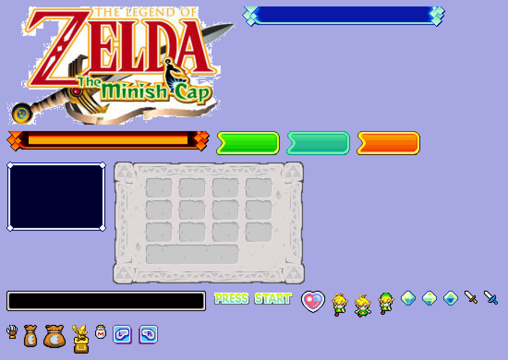

# Sheik Detector 🛡️

*The sharpest eye in all of Hyrule.*

Real-time object detection **in the browser**, styled after *The Legend of Zelda: The Minish Cap*.
It runs **YOLOX-nano** (trained on COCO, 80 classes) with
[onnxruntime-web](https://onnxruntime.ai/docs/tutorials/web/): images and camera frames never leave
the device, and the site is fully static, so it deploys to Vercel with no backend.

<p align="center">
  
</p>

## Features

- **Camera**: live detection from the webcam or phone camera. You can switch between the front and back camera, pause, and save a snapshot.
- **Image**: upload or drag and drop a picture and get it annotated. The result can be saved as a PNG.
- **Options**: minimum confidence, NMS threshold and the Minish Woods light-ray effect.
- **Inventory**: every detected class appears as a Minish Cap item with its count. The text box narrates what the Eye of Sheik found.
- **Responsive**: works on desktop and on phones (the camera needs HTTPS, which Vercel provides).

## Screenshots

| Quest select | Options |
|---|---|
|  |  |

| Detection | Detection |
|---|---|
|  |  |

<p align="center">
  
</p>

### Sprites used

Every panel, button and banner is a real Minish Cap sprite, cut from the sheets in
`assets-src/sheets/` and drawn as a 9-slice (`border-image`), so it scales at crisp pixel sizes.



## Deploy to Vercel

1. Import this repository at [vercel.com/new](https://vercel.com/new).
2. **Root Directory:** leave it as the repository root (`./`).
3. Vercel reads `vercel.json` (Vite framework, `npm run build`, output `dist/`), so you don't need to change anything.
4. Deploy.

`vercel.json` also sends the `Cross-Origin-Opener-Policy` and `Cross-Origin-Embedder-Policy` headers
so the WebAssembly runtime can use several threads, and it caches the model for a year.
`.vercelignore` keeps the old desktop app (`PC-yolo-old/`) out of the deployment.

## Run locally

```bash
npm install
npm run dev       # http://localhost:5173
npm run build     # production build in dist/
npm run preview   # serve dist/
```

## Model

| | |
|---|---|
| Model | YOLOX-nano, `yolox_nano.onnx` from Megvii's [release 0.1.1rc0](https://github.com/Megvii-BaseDetection/YOLOX/releases/tag/0.1.1rc0) |
| License | Apache 2.0 (see [`THIRD_PARTY_NOTICES.md`](THIRD_PARTY_NOTICES.md)) |
| Input | 416×416, BGR, 0–255, letterbox top-left padded with 114 (no normalization) |
| Output | 3549 × 85, decoded in `src/detector.js` (grid + stride, obj × class score, per-class NMS) |
| Size | 3.6 MB, in `public/models/` |
| Speed | ~100 ms per image on a desktop CPU (WebAssembly, multithreaded) |

The COCO model knows 80 everyday classes (person, car, dog, …). It is **not** trained to detect
damage (cracks, dents, rust, …). To detect damage, fine-tune YOLOX-nano on a damage dataset,
export it to ONNX with YOLOX's `tools/export_onnx.py`, drop the `.onnx` into `public/models/` and
point `src/config.js` at it with your class list.

## Project layout

```
index.html              three screens: title, quest select, detection
src/main.js             UI, camera/image flow, drawing, inventory and text box
src/detector.js         YOLOX preprocessing, ONNX inference and decoding/NMS
src/config.js           model path, input size and class names
src/style.css           pixel-art UI built from 9-slice sprites (border-image)
public/models/          yolox_nano.onnx
public/sprites/         sprites cut from the sheets in assets-src/sheets
tools/extract_assets.py regenerates public/sprites/ from the sheets (Python + Pillow)
scripts/copy-ort.js     copies the onnxruntime-web .wasm/.mjs into public/ort/ before dev/build
docs/screenshots/       images used in this README
PC-yolo-old/            the previous desktop app (YOLOv5 + Tkinter/OpenCV), kept for reference
```

## The old PC app

The original version was a local Windows desktop app built on YOLOv5 (Tkinter GUI + OpenCV
webcam window). It lives untouched in [`PC-yolo-old/`](PC-yolo-old/). See its
[README](PC-yolo-old/README.md) to run it with `python webcam_app.py`.

## Credits

- **YOLOX** © Megvii Inc., Apache License 2.0.
- *The Legend of Zelda: The Minish Cap* graphics © Nintendo / Capcom. This is a non-commercial fan
  project; it is not affiliated with or endorsed by Nintendo.
- Sprite sheets ripped by **EternalLight** (file select, pause menu), **Chaotic Death**
  (backgrounds and overlays), **Aquatics64** (font) and **Yue** (title screen), from
  The Spriters Resource.
- UI font: [Pixelify Sans](https://fonts.google.com/specimen/Pixelify+Sans) (SIL Open Font License).
